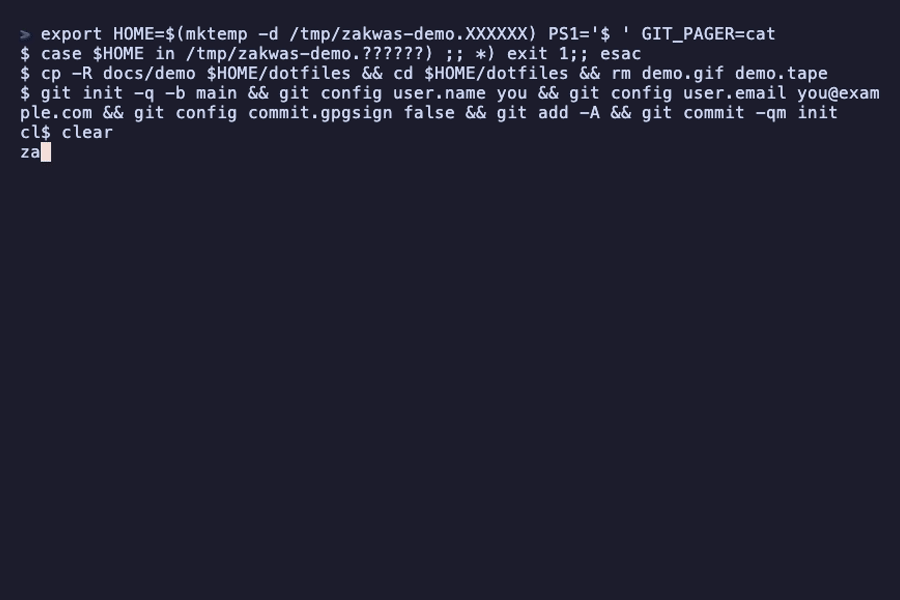

# zakwas

[](https://github.com/Automaat/zakwas/actions/workflows/ci.yml)
[](https://github.com/Automaat/zakwas/releases/latest)
[](LICENSE)

zakwas sets up a Mac from one YAML file. You list what the machine should have (dotfiles, Homebrew apps, CLI tool versions, macOS preferences, launchd jobs and the setup of your coding agents) and keep the file in a git repo. `zakwas plan` shows what would change, `zakwas apply` makes it so, and `zakwas check` tells you when the Mac drifted. It works on a fresh Mac and on the one you already use.

What it manages:

- **files / templates**: dotfiles as read-only copies, optionally immutable; edits go through the repo
- **links**: plain symlinks for configs apps must write themselves
- **brew**: apps and formulae from a `Brewfile`, with optional cleanup
- **mise**: CLI tools pinned in a global mise config
- **agents**: Claude Code, opencode and, when named, Codex, Gemini CLI and Copilot CLI: plugins, MCP servers, instructions, skills, permissions
- **defaults**: macOS preferences
- **system**: Touch ID for sudo, directories, SSH key
- **commands**: guarded one-off steps (`run` only while `check` fails)
- **launchd**: scheduled jobs as user agents

On Linux, the agents module, files, links, templates, commands and system `dirs`/`sshKey` work; the rest is macOS only. See [Linux](#linux).



*Zakwas* is Polish for sourdough starter: keep it, feed it, and every new loaf comes out the same.

## Who it is for

- **Fits:** you keep dotfiles in git and want apps, tool versions, macOS preferences and agent config declared in one place, with a plan before anything changes. You use several coding agents (Claude Code, Codex, opencode, Gemini CLI, Copilot CLI) and want their setup declared once. You want to know when a Mac drifted.
- **Does not fit:** Windows beyond the agent features (see [Windows](#windows-early)), or Linux if you need Homebrew, mise or preferences managed (those modules are macOS only; see [Linux](#linux)). Many machines from a server (zakwas converges the Mac it runs on, as your user). Building packages (it hands that to Homebrew and mise; see [Compared to](#compared-to)). Secrets (keep them out of the config repo).

## Status

- **Pre-1.0.** The config format can change between minor versions; check the [release notes](https://github.com/Automaat/zakwas/releases) before upgrading. Machine-readable output carries its own `format_version`.
- **macOS first, Linux and Windows in part.** Release binaries are darwin and linux (tar.gz) and windows (zip), arm64 and amd64. CI runs on macOS 26, Ubuntu and Windows; older macOS versions are not tested. See [Linux](#linux) and [Windows](#windows-early) for what works there.
- **One maintainer.** Issues and PRs get answered when there is time; see [.github/SUPPORT.md](.github/SUPPORT.md).
- **Not notarized.** `install.sh` and `zakwas self-update` verify checksums, and build provenance when a logged-in `gh` is available.

If something breaks on first use, start with [docs/troubleshooting.md](docs/troubleshooting.md).

## Try it in two minutes

Nothing on your Mac changes until the last command, and that one shows its plan and asks first.

```bash
git clone https://github.com/Automaat/zakwas.git && cd zakwas
./install.sh --dir examples --no-apply     # installs only zakwas, to ~/.local/bin
export PATH="$HOME/.local/bin:$PATH"
zakwas init ~/dotfiles --add ~/.zshrc      # writes a starter repo in ~/dotfiles, nothing else
cd ~/dotfiles && zakwas plan               # read-only
zakwas apply --only files                  # confirm, then ~/.zshrc and a mise config are installed
```

- On a Mac without the Xcode Command Line Tools, run `xcode-select --install` first and wait for it to finish; `git` comes with them.
- `init` writes `zakwas.yaml`, a `Brewfile` from what Homebrew has installed, your global mise tools pinned to their current versions, and a copy of each file you `--add`. It does not apply anything.
- `apply --only files` limits the run to the `files` module: your `~/.zshrc`, plus `~/.config/mise/config.toml` when `init` found mise (an existing one is backed up first).
- After `apply`, `~/.zshrc` is read-only and immutable: edit `~/dotfiles/dotfiles/zshrc` and apply again. A warning about uncommitted changes is expected until you commit the new repo. To undo, see [Stop managing a file](docs/troubleshooting.md#stop-managing-a-file-or-remove-zakwas).
- Next, [Getting started](docs/getting-started.md) walks the normal loop. [`examples/`](examples) is a complete sample config repo (`zakwas.yaml`, a `Brewfile`, dotfiles and an `agents` section); from the clone, `zakwas -c examples/zakwas.yaml plan --only files,agents` changes nothing.

## Install

| How | Command | Updates |
|---|---|---|
| installer (new Mac) | see [New Mac](#new-mac) | `zakwas self-update` |
| Homebrew (macOS) | `brew install automaat/tap/zakwas` | `brew upgrade zakwas` |
| mise | `"github:Automaat/zakwas" = "X.Y.Z"` in your mise config | bump the pin (Renovate does it) |
| Go | `go install github.com/Automaat/zakwas/cmd/zakwas@latest` | same command |

Shell completion: `zakwas completion zsh|bash|fish` ([docs/commands.md](docs/commands.md#completion)).

## New Mac

Push `~/dotfiles` to GitHub and any other Mac is one command away:

```bash
curl -fsSL https://raw.githubusercontent.com/Automaat/zakwas/main/install.sh |
  bash -s -- --repo https://github.com/you/dotfiles.git
```

It installs the Command Line Tools and zakwas, clones your config to `~/dotfiles`, then runs `zakwas apply`. On Linux the same command skips the Command Line Tools step. zakwas installs Homebrew and mise itself when the config needs them. The options (`--no-apply`, `--dir`, `--version`) are in [Getting started](docs/getting-started.md#set-up-a-second-mac).

## Linux

The agent features work on Linux: the `agents` module, `capture`, `propose` / `proposals` / `approve`, `zakwas mcp` and the guard. So do `files`, `links`, `templates`, `commands` and `system` (`dirs` and `sshKey`). Release binaries and `install.sh` cover Linux amd64 and arm64 (the installer needs `bash`, `curl` and `tar`); the installer skips the Xcode step and ends with a hint when `~/.local/bin` is not on `PATH`.

macOS only: `brew`, `mise`, `defaults`, `launchd` and `system.sudoTouchID`. A config that uses one on Linux is rejected with a one-line message that names it, so nothing is skipped silently. `protect.immutable` has no `uchg` flag on Linux: files stay read-only (`0444`) copies tracked by hash, and the plan says so. [`examples/linux/zakwas.yaml`](examples/linux/zakwas.yaml) is a config that plans there, and [Platform support](docs/config.md#platform-support) lists every module and option.

## Agents

Declare MCP servers, instructions, skills, profiles and permissions once; zakwas renders each agent's native format. Claude Code and opencode are converged by default; Codex, Gemini CLI and Copilot CLI only when you name them in `agents.providers`.

```yaml
agents:
  providers: [claude, codex]
  instructions: dotfiles/AGENTS.md
  mcp:
    docs: {command: npx, args: [-y, "@example/docs-mcp"], envVars: [DOCS_TOKEN]}
```

Secrets stay environment references. With an `agents` section, a guard denies the managed agents `zakwas apply`; they can `propose` changes, and you `approve` them in a terminal. See [docs/agents.md](docs/agents.md).

## Windows (early)

Windows runs the agent features and the portable core: `agents` (plugins, marketplaces, MCP servers, instructions, permissions, profiles and command hooks), `propose`, `proposals`, `approve`, `capture`, `zakwas mcp`, `files`, `templates`, and `plan`, `check` and `apply` for those. Install from PowerShell, then use it as on a Mac:

```powershell
irm https://raw.githubusercontent.com/Automaat/zakwas/main/install.ps1 -OutFile install.ps1
powershell -NoProfile -ExecutionPolicy Bypass -File .\install.ps1 -AddToPath
```

Windows PowerShell 5.1 blocks scripts by default (`Restricted`), so the command above lifts the policy for that one process only and changes nothing on the machine. PowerShell 7 runs `.\install.ps1 -AddToPath` directly.

`install.ps1` checks the release zip against `checksums.txt` and installs `zakwas.exe` to `%LOCALAPPDATA%\Programs\zakwas`. You can also unzip a `zakwas_X.Y.Z_windows_<arch>.zip` from the [releases](https://github.com/Automaat/zakwas/releases) yourself.

Not supported yet: the macOS modules (`brew`, `defaults`, `system.sudoTouchID`, `launchd`), `system`, `mise`, `commands` (they run `sh`), `links` and `agents.skills` (they need symlinks). A config that uses one is rejected with a one-line message, as on Linux; see [Platform support](docs/config.md#platform-support). Also unsupported: opencode's hook plugin and the Gemini extension link (their plans fail), `zakwas self-update`, and `protect.immutable` (files are only read-only). `install.ps1` checks the zip against `checksums.txt` but does not verify the build attestation. The guard's deny rules cover the Bash form of `zakwas apply`, not PowerShell, `cmd` or `zakwas.exe`; the refusal to apply from an agent session still works. Windows is tested on `windows-latest` only. See [docs/agents.md](docs/agents.md#windows) and [troubleshooting](docs/troubleshooting.md#windows).

## Protected dotfiles

`files` and `templates` write copies with write bits stripped; `protect.immutable` adds the macOS `uchg` flag (on Linux files stay read-only copies). To change one, edit it in the repo and `zakwas apply`. A file zakwas did not write, or that was edited in place, is backed up to `<file>.zakwas-bak` before it is replaced. See [docs/config.md](docs/config.md#files) and [troubleshooting](docs/troubleshooting.md#the-plan-shows-edited-in-place-or-not-managed-yet-and-a-zakwas-bak-file).

## Security model

zakwas runs as your user, and your config repo is code that runs as you: apply only a config you trust. `plan` and `check` never change the system. `sudo` is used only during `apply`, for Touch ID and the Homebrew installer. Downloads are checksum-verified, and the Homebrew installer and mise are pinned. Details and limits, including what the agent guard does not stop, are in [docs/security.md](docs/security.md). Report a vulnerability through [SECURITY.md](SECURITY.md), not a public issue.

## Compared to

- **nix-darwin / home-manager**: the same "machine = repo" model without learning Nix. zakwas delegates packages to Homebrew and mise, so there is no store or evaluation.
- **chezmoi / stow / yadm**: built around dotfiles, with scripts (chezmoi's `run_` scripts, yadm's bootstrap) for everything else. zakwas has typed modules for apps, tool versions, preferences and one-off steps, plans them all, and protects installed files.
- **A Brewfile plus a shell script**: fine until the script is not idempotent or you forget what it changed. zakwas plans before it acts, records every apply, and `check` tells you when the machine drifted.

## Documentation

- [docs/getting-started.md](docs/getting-started.md): the normal loop, from `init` to a second Mac
- [docs/commands.md](docs/commands.md): commands, flags, output, JSON, exit codes, environment
- [docs/config.md](docs/config.md): every key in `zakwas.yaml`, editor setup
- [docs/recipes.md](docs/recipes.md): snippets for common setups
- [examples/](examples): a complete sample config repo ([examples/zakwas.yaml](examples/zakwas.yaml))
- [docs/agents.md](docs/agents.md): coding agents: what each supports and the capture, propose, approve flow
- [docs/security.md](docs/security.md): what zakwas verifies, the agent guard, when it uses sudo
- [docs/troubleshooting.md](docs/troubleshooting.md): first-use failures, backups, state files, removing zakwas
- [CONTRIBUTING.md](CONTRIBUTING.md), [CODE_OF_CONDUCT.md](CODE_OF_CONDUCT.md), [SECURITY.md](SECURITY.md), [.github/SUPPORT.md](.github/SUPPORT.md)

## Contributing

Issues and PRs are welcome; [CONTRIBUTING.md](CONTRIBUTING.md) covers setup (`mise run test`, `mise run lint`), how to add a module or an agent provider, and the commit and PR format. [CLAUDE.md](CLAUDE.md) has the layout and conventions. Everyone taking part follows the [Code of Conduct](CODE_OF_CONDUCT.md).

## License

MIT
